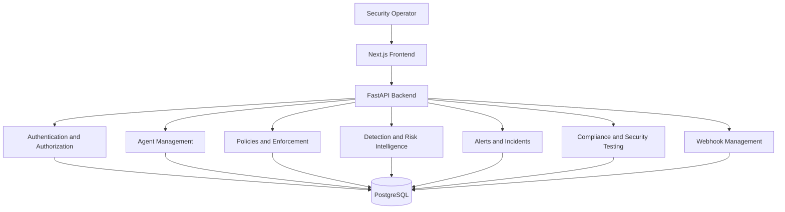

# SentinelX — System Architecture

## High-level overview

## Technology stack

| Layer | Technology |
|---|---|
| Frontend | Next.js, React, TypeScript, Tailwind CSS |
| Backend | Python, FastAPI |
| Database | PostgreSQL |
| ORM and migrations | SQLAlchemy, Alembic |
| Authentication | JWT and Argon2 |
| Testing | Pytest and frontend test tooling |

## Main capability areas

- Agent management
- Authentication and access control
- Policy management and enforcement
- Tool and guardrail management
- Security events and detection rules
- Risk scoring and analytics
- Security alerts and incident management
- Compliance mappings and security testing
- Webhook management

## Security boundary

The frontend communicates with the backend API. The backend manages application operations and database access.

Webhook delivery is a separate operational concern. Production webhook worker activation remains restricted until connection-time SSRF protection and outbound network restrictions are independently verified.

## Scope

SentinelX is a standalone project. It is not integrated with CIMP.